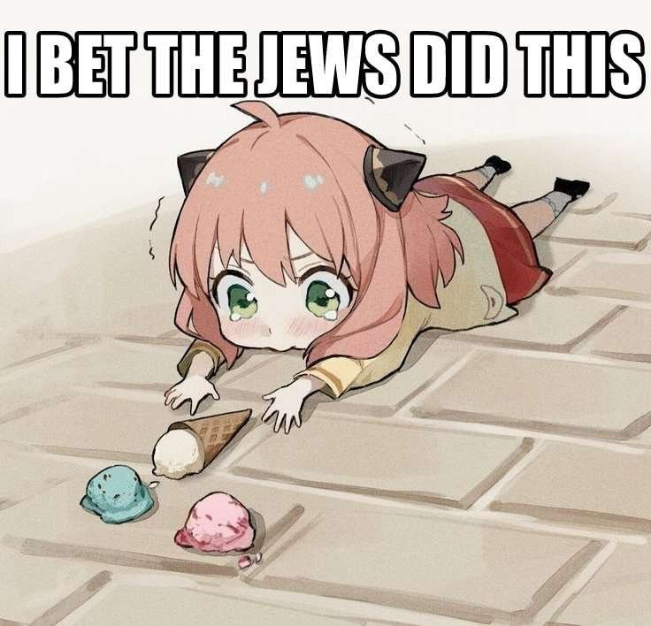

# Cursed Converter

Rearranges the pixels of one image until another image appears — the same idea as
[obamify](https://github.com/Spu7Nix/obamify). Runs entirely in the browser.

**Live demo:** <https://jewnyk23.github.io/cursed-converter/>

The app opens with this pair loaded; the GIF above was made with the default
settings: 208×208 grid, proximity 0.3, 3.3 s morph, 2 s holds, 60 fps.

| Source | Target |
|---|---|
|  |  |

## Usage

1. Open the demo, or `index.html` locally (double-click, or `python3 -m http.server`).
2. Drop a **source** image (its pixels get rearranged) and a **target** image
   (the shape that emerges). Clipboard paste and sample images work too.
3. **Convert**, then **Export GIF** (N×N at 15/24/30/60 fps) or **Export Video**
   (`.webm` via MediaRecorder). **Replay** re-runs the animation without re-solving.

## Settings

| Setting | What it does |
|---|---|
| Resolution | Grid size, 32–512. This is also the **output size**: preview, GIF and video are all exactly N×N, one pixel per cell. |
| Proximity weight | 0–1, how much position counts next to colour. High = pixels stay near home and the morph stays subtle. |
| Morph duration | 0.5–10 s of animation. |
| Source / final hold | 1–10 s held before and after the morph (the first and last GIF frame delays). |
| GIF frame rate | 15/24/30/60 fps. GIF delays are whole centiseconds, so 60 fps is written as 2 cs and plays back at 50 fps. |

## How it works

1. Both images are center-cropped to a square and sampled onto an N×N grid.
2. Each pixel becomes a 5D point `(r, g, b, x·k, y·k)` where `k` is the proximity
   weight, so matching is nearest-neighbour in colour *and* position.
3. Source and target points are paired by **recursive bipartite partitioning**:
   cut both sets at the median of their widest dimension, recurse, solve leaves of
   16 greedily, then two sweeps swap adjacent cells wherever a swap lowers the
   cost. The result is a permutation.
4. The animation interpolates every cell from its old position to its new one.
5. GIF encoding: per-frame median-cut palette, Floyd–Steinberg dithering, LZW.
